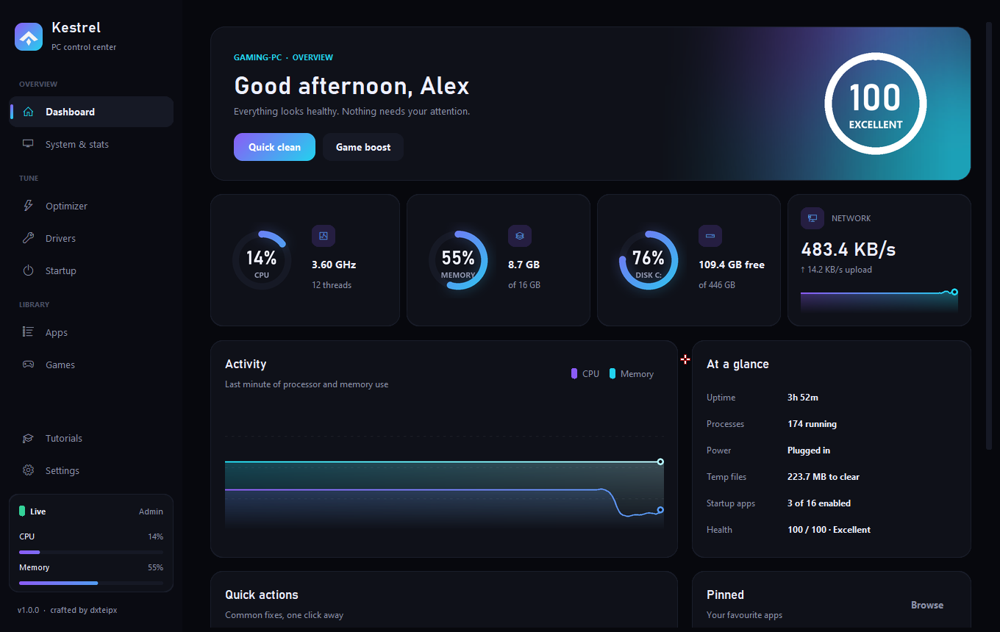
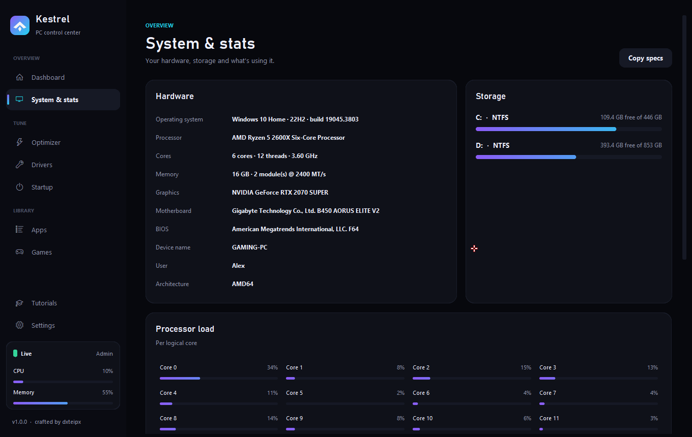
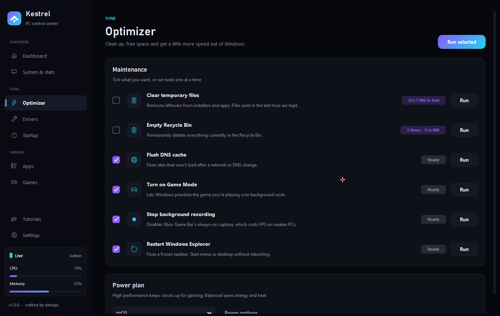
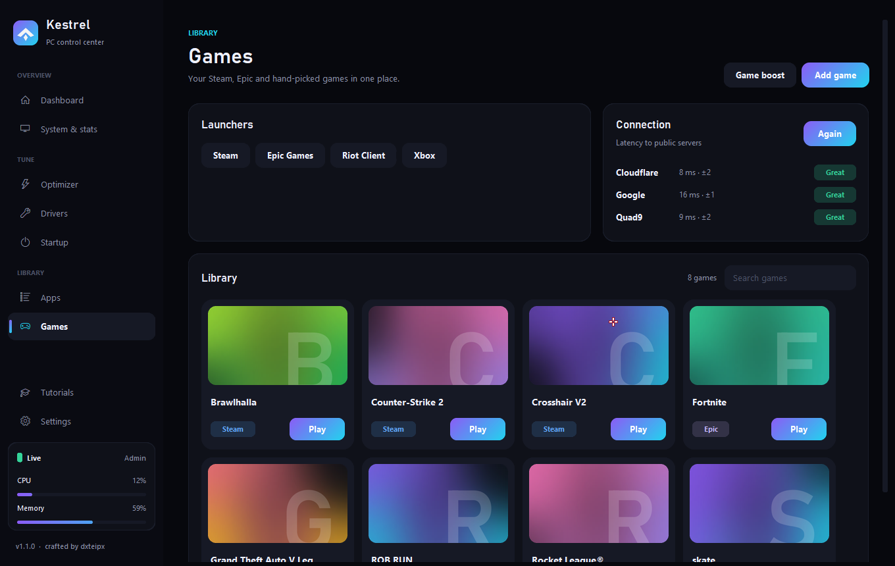
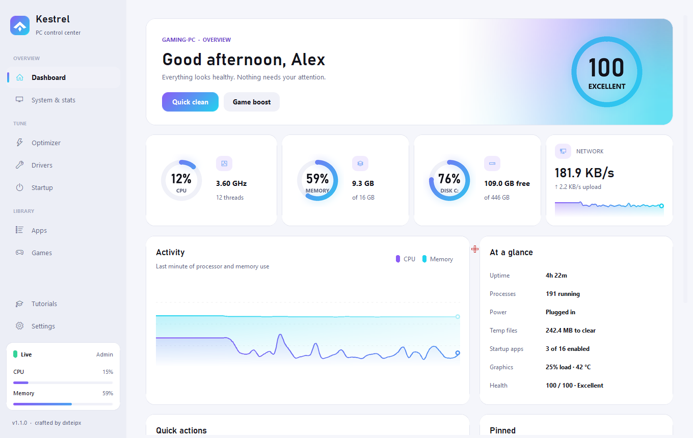
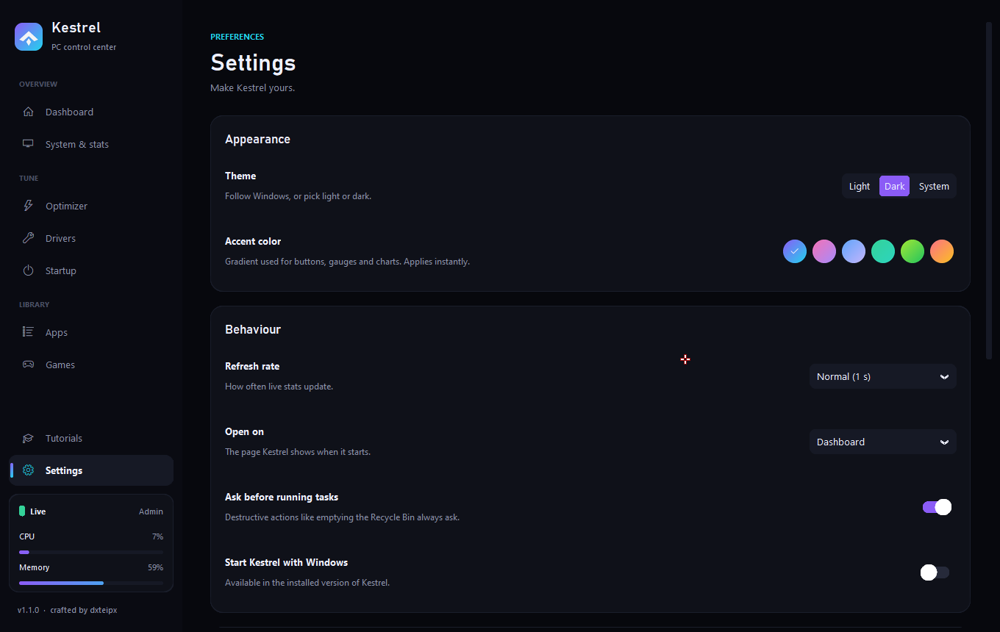
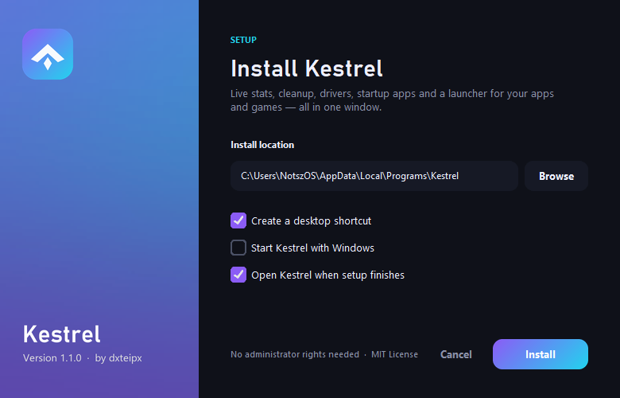

<div align="center">


# Kestrel

**A calm, all-in-one control center for Windows.**
Live stats, cleanup, drivers, startup apps and a launcher for your apps and games — in one window.

[](https://github.com/dxteipx/Kestrel/releases/latest)
[](#)
[](https://www.python.org/)
[](LICENSE)

[**Download**](https://github.com/dxteipx/Kestrel/releases/latest) · [Features](#features) · [Build from source](#build-from-source) · [Contributing](CONTRIBUTING.md)

<br>



</div>

## Features

| | |
| --- | --- |
| **Dashboard** | Health score, live gauges for CPU, memory and storage, GPU load and temperature, activity charts, one-click fixes and pinned apps |
| **System & stats** | Full hardware profile you can copy, every drive, live NVIDIA GPU stats, per-core load and the busiest processes (with End task) |
| **Optimizer** | Restore points, temp files, browser caches, Recycle Bin, DNS flush, Game Mode, background recording, Explorer restart, power plans |
| **Drivers** | Lists installed drivers, finds updates on Windows Update, installs them and backs them up |
| **Startup** | Turn startup programs on or off — the same way Task Manager does, nothing gets deleted |
| **Apps** | Every installed app (Store apps included), searchable and pinnable, plus the Windows tools you keep looking for |
| **Games** | Picks up Steam and Epic libraries, detects launchers, add any game by hand, Game boost and a ping / packet-loss test |
| **Tutorials** | Short, practical guides that link straight to the right page |
| **Settings** | Light and dark themes, six gradient accents applied live, start with Windows, refresh rate, start page, admin mode, error log |
| **Account** | Optional sign-in with Supabase, kept encrypted on your PC — [setup guide](docs/SUPABASE.md) |
| **Updates** | Checks GitHub Releases every hour while open, then downloads and installs new versions by itself |

Press <kbd>Ctrl</kbd> + <kbd>1</kbd>–<kbd>9</kbd> to jump between sections.

## Screenshots

<table>
  <tr>
    <td></td>
    <td></td>
  </tr>
  <tr>
    <td></td>
    <td></td>
  </tr>
  <tr>
    <td></td>
    <td></td>
  </tr>
</table>

## Install

Grab **`Kestrel-Setup.exe`** from the [latest release](https://github.com/dxteipx/Kestrel/releases/latest) and run it.

- Installs for your user only — **no administrator rights needed**
- Adds Start menu and desktop shortcuts, and can start Kestrel with Windows
- Shows up in **Settings → Apps**, where you can uninstall it like any other app
- Keeps itself up to date: new releases install automatically (you can turn this off in Settings)

> Windows SmartScreen may warn about an unknown publisher because the installer isn't code-signed.
> Click **More info → Run anyway**.

Some actions — machine-wide startup items, the Windows Temp folder, installing drivers — need administrator rights. Kestrel asks Windows for them only when needed, or you can restart it as admin from **Settings**.

## Build from source

Requires Windows 10 or 11 and Python 3.10+.

```bash
git clone https://github.com/dxteipx/Kestrel.git
cd kestrel
pip install -r requirements.txt
python main.py
```

Run the tests and build the installer yourself:

```bash
pip install -r requirements-dev.txt
python -m pytest
python packaging/build.py
```

The result is `dist/Kestrel-Setup-<version>.exe`. Pushing a tag such as `v1.0.1` builds it on GitHub Actions and attaches it to a new release automatically.

### Shipping an update

1. Bump `__version__` in `kestrel/__init__.py` and add the changes to `CHANGELOG.md`.
2. Commit, then tag and push: `git tag v1.0.1 && git push --tags`.

GitHub Actions publishes the release, and every installed copy picks it up within the hour.

## Project layout

```
main.py                  entry point
tests/                   unit tests (pytest)
packaging/
├── build.py             builds Kestrel.exe and the installer
└── installer.py         the setup / uninstall wizard
kestrel/
├── app.py               main window, navigation, toasts, refresh loop
├── config.py            settings saved to %APPDATA%\Kestrel
├── cloud.py             Supabase project URL and public key
├── theme.py             palette, gradient accents and fonts
├── icons.py             Segoe Fluent / MDL2 glyphs
├── formatting.py        sizes, rates and durations
├── instance.py          single-instance lock
├── log.py               rotating error log
├── content/
│   └── tutorials.py     guide text (plain data, easy to translate)
├── core/                Windows logic — no UI code in here
│   ├── system.py        live metrics, hardware profile, processes
│   ├── health.py        the 0–100 health score
│   ├── gpu.py           live NVIDIA GPU stats
│   ├── network.py       ping, jitter and packet loss
│   ├── updater.py       checks GitHub Releases and installs updates
│   ├── account.py       Supabase sign-in and sessions
│   ├── vault.py         DPAPI encryption for the saved session
│   ├── optimizer.py     maintenance tasks and power plans
│   ├── drivers.py       installed drivers and Windows Update
│   ├── startup.py       startup programs
│   ├── launcher.py      apps, games and launchers
│   └── shell.py         PowerShell, elevation, opening things
└── ui/
    ├── art.py           Pillow renderer: gradients, gauges, charts, covers, logo
    ├── widgets.py       cards, gauges, buttons, tables, dialogs
    ├── sidebar.py
    ├── background.py    runs slow work off the UI thread
    └── pages/           one file per section
```

Every gauge, chart, cover and the logo are drawn with Pillow at runtime, so there are no image assets to ship.

### Adding a page

1. Create `kestrel/ui/pages/yourpage.py` with a `Page` subclass that builds its UI in `build()`.
2. Export it from `kestrel/ui/pages/__init__.py`.
3. Add it to `NAVIGATION` in `kestrel/app.py`.

`on_show()` runs every time the page opens, `on_tick(snapshot)` on every stats refresh while it's visible.

## Contributing

Issues and pull requests are welcome — see [CONTRIBUTING.md](CONTRIBUTING.md) for how the code is organised and what a good PR looks like.

## Credits

Kestrel is designed and developed by **[dxteipx](https://github.com/dxteipx)**.
Built with [CustomTkinter](https://github.com/TomSchimansky/CustomTkinter), [psutil](https://github.com/giampaolo/psutil) and [Pillow](https://python-pillow.org/).

## License

[MIT](LICENSE) © dxteipx
